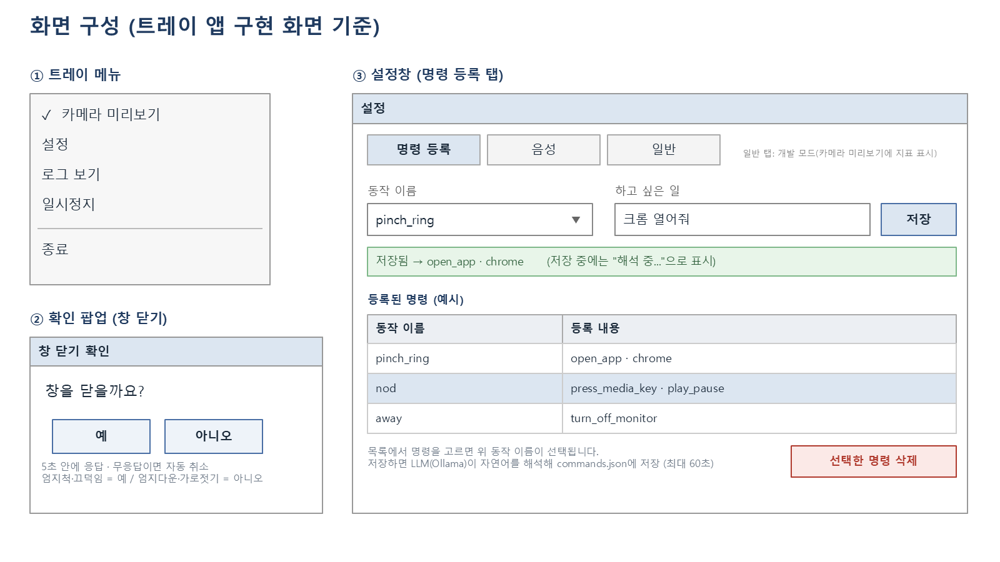

# 메뉴 구조

| 항목 | 내용 |
|---|---|
| 프로젝트 | gesture-pc-assistant |
| 문서 기준일 | 2026-11-17 |
| 문서 성격 | 트레이 앱(`app/`) 1단계부터 5단계까지 구현된 상태를 기준으로, 처음 설계와 달라진 점을 함께 적는다. 콘솔 + 카메라 창 실행(루트)은 실험용으로 따로 남아 있다 |
| 관련 문서 | 기능명세서 (기능별 판정 규칙), 유저흐름도 (시나리오), 플로우 차트. 화면 구성은 7절 와이어프레임 1장으로 갈음하며 별도 UI 명세서는 두지 않는다 |

## 1. 설계 원칙

| 원칙 | 내용 |
|---|---|
| 평소에는 보이지 않음 | 콘솔 창과 카메라 창을 띄우지 않고 시스템 트레이 아이콘만 상주한다 |
| 메뉴는 단순하게 | 트레이 메뉴는 Ollama 트레이 메뉴처럼 한 단계 목록으로 둔다 |
| 설정은 한 곳에 | 명령 등록을 포함한 설정은 설정창 하나에서 한다 |
| 확인용 카메라 | 설정이 제대로 적용되어 인식되는지 확인할 수 있도록, 랜드마크 점과 연결선만 그려진 카메라 창(일반 모드)을 열 수 있다. 개발 모드를 켜면 지표도 함께 표시한다 |
| 알림으로 피드백 | 콘솔 로그 대신 알림과 팝업으로 알리고, 상세 기록은 로그 파일에 남긴다 |

## 2. 전체 구조

| 1단계 | 2단계 | 종류 | 설명 |
|---|---|---|---|
| 트레이 아이콘 | 트레이 메뉴 | 상시 | 실행 중 항상 존재하는 유일한 진입점 |
| 트레이 아이콘 | 카메라 미리보기 창 | 선택 표시 | 트레이 메뉴에서 켜고 끔 |
| 트레이 아이콘 | 설정창 | 선택 표시 | 트레이 메뉴에서 열고 닫음 |
| 자동 표시 | 알림 | 이벤트 발생 시 | 모드 전환, 자리 비움, 캡처 저장 등 |
| 자동 표시 | 확인 팝업 | 이벤트 발생 시 | 창 닫기 확인 |

## 3. 트레이 메뉴

| 순서 | 메뉴 | 동작 | 구현 |
|---|---|---|---|
| 1 | 카메라 미리보기 | 확인용 카메라 창을 켜고 끈다 (체크 표시로 상태 표시). 창에서 `q`를 누르거나 X로 닫으면 앱은 종료되지 않고 미리보기만 닫힌다 | 구현 |
| 2 | 설정 | 설정창을 연다. 이미 열려 있으면 새 창을 만들지 않고 앞으로 가져온다 | 구현 |
| 3 | 로그 보기 | 로그 파일(`app/logs/assistant.log`)을 연다 | 구현 |
| 4 | 일시정지 / 재개 | 인식·마우스 제어·명령 실행·웨이크워드 검사를 모두 멈추고 다시 시작한다 (항목 이름이 상태에 따라 바뀜) | 구현 |
| (구분선) | | | |
| 5 | 종료 | 정리 후 프로그램을 종료한다 | 구현 |

모델 로딩이 끝나기 전에는 미리보기·설정·일시정지 항목이 비활성이다.

### 3.1 트레이 아이콘 상태 표시

| 상태 | 표시 |
|---|---|
| 시작하는 중 (모델 로딩) | 주황색 아이콘 |
| 정상 실행 | 파란색 아이콘 |
| 일시정지 | 회색 아이콘 |
| 중지됨 (카메라를 열 수 없는 경우 등) | 빨간색 아이콘, 툴팁에 "로그를 확인하세요". 별도 알림은 없고 로그에만 원인이 남는다 |

## 4. 설정창

탭으로 구성한다. 현재는 **명령 등록**, **음성**, **일반(개발 모드)** 세 탭이다.

| 탭 | 항목 | 설명 | 상태 |
|---|---|---|---|
| 명령 등록 | 동작 이름 선택 | 목록에서 고른다: `swipe_up`, `swipe_down`, `close_confirm`, `pinch_middle`, `pinch_ring`, `pinch_pinky`, `nod`, `shake`, `away`, `back` | 구현 |
| 명령 등록 | 하고 싶은 일 입력 | 자연어 텍스트 입력칸 (예: 크롬 열어줘). Enter로도 저장 | 구현 |
| 명령 등록 | 저장 버튼 | LLM 해석(최대 60초) 중에는 "해석 중..."을 표시하고, 끝나면 해석 결과(action, target)를 상태 줄에 보여 주며 알림도 띄운다 | 구현 |
| 명령 등록 | 등록된 명령 목록 | 동작 이름별 현재 등록 내용. 목록에서 명령을 고르면 위의 동작 이름이 함께 선택된다 | 구현 |
| 명령 등록 | 삭제 | 목록에서 명령을 고르고 "선택한 명령 삭제" 버튼 (확인 창 후 삭제) | 구현 |
| 음성 | 음성 명령 사용 | 끄면 웨이크워드 감지(GPU 사용)와 손등 3초 음성 트리거가 모두 멈춘다. 설정은 재시작 후에도 유지된다 | 구현 |
| 음성 | 웨이크워드 변경 | 현재 "웨이크"(임시 단어) | 미구현 |
| 일반 | 개발 모드 | 카메라 미리보기에 랜드마크 점·선 외에 FPS·모드·판정 수치 등 지표를 표시. 켜 둔 미리보기에는 바로 반영 | 구현 |
| 일반 | 캡처 저장 폴더 | ㅡ자 자세 캡처 저장 위치 | 미구현 |
| 일반 | 시작 시 자동 실행 | 윈도우 시작과 함께 실행 | 미구현 |
| 인식 조정 | 임계값 | 끄덕임, ㅡ자 유지 시간 등 | 미구현 (선택 항목) |

처음 설계에는 "카메라" 탭(미리보기 켜기/끄기)이 있었지만, 같은 기능이 트레이 메뉴에 있어서 만들지 않았다.

### 4.1 명령 등록 시 오류 안내

상태 줄에 아래 문구가 표시된다 (`commandmodule.py`가 돌려주는 문구를 그대로 사용).

| 상황 | 표시 문구 |
|---|---|
| Ollama가 꺼져 있음 | "Ollama에 연결할 수 없습니다 (서버가 꺼져 있는지 확인하세요)" |
| LLM 응답 시간 초과(60초) | "Ollama 응답이 60초 안에 오지 않았습니다" |
| 해석 결과가 지원하지 않는 동작 | "인식 실패 또는 지원하지 않는 동작입니다" + 해석 결과 |
| 대상(target)이 허용 목록에 없음 | "target을 알아듣지 못했습니다" + 해석 결과 |

모델이 메모리에 올라오기 전의 첫 요청은 60초를 넘겨 실패할 수 있다. 이 경우 같은 내용을 한 번 더 저장하면 된다.

## 5. 카메라 미리보기 창

| 모드 | 표시 내용 |
|---|---|
| 일반 모드 (기본) | 카메라 영상 위에 손(21점) 또는 몸(상체) 랜드마크 점과 연결선만 표시. FPS, 모드 글자, 상태 문구, elbow·head 수치, 박스, 자세 이름, 진행률 등 지표는 표시하지 않음 |
| 개발 모드 | 위 점·선에 더해 모든 지표를 표시. 오인식 원인을 찾거나 임계값을 조정할 때 사용 |

| 항목 | 내용 |
|---|---|
| 목적 | 설정이 제대로 적용되어 인식되는지 눈으로 확인 |
| 열고 닫기 | 트레이 메뉴 (설정창에서는 열고 닫지 않음) |
| 모드 전환 | 설정창 일반 탭의 개발 모드 체크 |
| 구현 방식 | 지표 그리기 코드는 그대로 두고, 일반 모드에서는 지표를 버려지는 복사본 화면에 그린다. 점·선만 실제 화면에 그린다 |
| 확인 상태 | 포즈 모드에서 일반·개발 두 모드의 화면 차이를 확인했다. 손 모드의 손 점은 일반 모드에서 직접 확인하지 못했다 |

콘솔로 실행하는 루트의 `main.py`와 `app/main.py`는 예전처럼 개발 모드(지표 전부 표시)로 시작한다.

## 6. 알림과 팝업

| 종류 | 상황 | 표시 내용 | 응답 | 상태 |
|---|---|---|---|---|
| 알림 | 모드 전환 | "손동작 모드" / "전신 포즈 모드" | 없음 | 구현 |
| 알림 | 자리 비움 / 복귀 | "자리 비움을 감지했습니다" / "자리에 돌아왔습니다" (등록된 명령을 실행했으면 그 사실도 표시) | 없음 | 구현 |
| 알림 | 화면 캡처 | "화면을 저장했습니다" + 저장 경로, 실패 시 사유 | 없음 | 구현 |
| 알림 | 음성 명령 | "듣고 있습니다", 실행 성공 / 실패 사유 | 없음 | 구현 |
| 알림 | 명령 저장 결과 | 저장된 이름과 해석 결과, 실패 시 사유 | 없음 | 구현 |
| 알림 | 첫 실행 안내 | 처음 실행하면 사용법을 한 번 안내 | 없음 | 구현 |
| 알림 | Ollama 점검 | 시작할 때 Ollama가 꺼져 있거나 모델이 없으면 안내 (실행할 때마다) | 없음 | 구현 |
| 알림 | 오류 (카메라 없음, GPU 없음) | 아이콘이 빨간색으로 바뀌고 로그에 남음. 알림은 아직 없음 | 없음 | 미구현 |
| 확인 팝업 | 창 닫기 확인 | "창을 닫을까요?", 닫을 창 제목, 예/아니오 버튼, 5초 카운트다운 | 버튼, 또는 엄지척·끄덕임(예) / 엄지다운·가로젓기(아니오). 무응답이면 자동 취소 | 구현 |

- 알림은 윈도우 알림이라 **방해 금지가 켜져 있으면 배너가 표시되지 않는다** (알림 센터에는 쌓인다).
- 확인 팝업은 포커스를 가져가지 않으며, 확인을 **시작한 순간의 활성 창**을 닫는다 (팝업이 앞에 있어도 엉뚱한 창이 닫히지 않게 함).

## 7. 화면 구성 (와이어프레임)

| 번호 | 화면 | 구성 요소 | 설명 |
|---|---|---|---|
| ① | 트레이 메뉴 | 카메라 미리보기(체크 표시), 설정, 로그 보기, 일시정지, 종료 | 3절의 메뉴와 같다. 일시정지 중에는 항목 이름이 "재개"로 바뀐다 |
| ② | 확인 팝업 | 제목, 안내 문구, 예·아니오 버튼, 응답 수단 안내 | 5초 안에 응답이 없으면 자동 취소. 버튼 대신 엄지척·끄덕임(예), 엄지다운·가로젓기(아니오)로도 응답 |
| ③ | 설정창 | 탭(명령 등록·음성·일반), 동작 이름 선택, 하고 싶은 일 입력, 저장 버튼, 상태 줄, 등록된 명령 목록, 선택한 명령 삭제 버튼 | 저장 중에는 "해석 중..."을 표시하고 끝나면 해석 결과를 보여 준다. 목록의 명령 3개는 예시이다 |

처음 설계 이미지와 달라진 점: 카메라 탭을 없앴고, 삭제는 행마다 두지 않고 목록 아래의 버튼 하나로 했다. 알림은 화면 형태가 단순해서(제목 한 줄 + 내용 한 줄) 따로 그리지 않고 6절의 목록으로 갈음한다.

## 8. 콘솔 실행과 트레이 앱의 대응

| 콘솔 + 카메라 창 (실험용) | 트레이 앱 (구현) |
|---|---|
| 콘솔 창이 항상 열림 | 콘솔 없음, 트레이 아이콘만 |
| 카메라 창에 지표와 글자 표시 | 기본 꺼짐, 켜면 점·선만 표시 (개발 모드에서 지표도 표시) |
| 콘솔에 `이름: 내용` 입력하여 명령 등록 | 설정창의 명령 등록 탭 |
| 콘솔 로그로 이벤트 확인 | 알림 + 로그 파일 |
| 창 닫기 확인을 콘솔 로그로 안내 | 확인 팝업 |
| 카메라 창에서 `q`로 종료 | 트레이 메뉴의 종료 (`q`는 미리보기만 닫음) |
| 일시정지 없음 | 트레이 메뉴의 일시정지 / 재개 |

## 9. 결정 사항

처음 설계에서 "결정이 필요한 점"으로 남겼던 것의 결과.

| 항목 | 결정 | 이유 |
|---|---|---|
| 트레이 메뉴의 모드 전환 | 넣지 않음 | 양손 모으기 제스처로만 전환. 메뉴가 단순하게 유지됨 |
| 설정창 1차 범위 | 명령 등록 + 음성 + 일반(개발 모드) | 나머지 2차 항목은 필요해질 때 추가 |
| 개발용 전체 지표 화면 | 설정의 개발 모드로 남김 | 오인식 원인 파악에 계속 필요 |
